#

# Desenvolvimento de Aplicações Distribuídas

# Lab 04 - Data Persistence

## Objective

This worksheet will help us learn about the integration between VueJS and the data persistence, and authentication/authorization features of Laravel.

## Prerequisites

Building upon the concepts covered in Worksheet 3 (Lab03-MemoryGame), where we explored the basics of Vue.js, Vue Router, and the Pinia store to create a single-player Memory Game.

To avoid any inconsistencies, use the provided solution repository by following the instructions in [Initial Setup](initial_setup.md) to set up your development environment and install the dependencies for all projects.


## Laravel API - Models, Controllers, Routes and Form Requests

Our first step is to set up a way to store games in our API. To this end we need to create a few Laravel components:
    * A Game model: used by Laravel Eloquent to interact with our SQLite database.
    * A Games table migration: used to create our games table.
    * A Games controller: where all the methods related to games are going to be.
    * A Games FormRequest: used to validate the inputs for the POST request that is going to create a new game

Laravel is very opinionated when it comes to here files live and some of their naming conventions. Instead of us creating every one of these things manually let’s use the available artisan commands.

1. Run the following commands in the `\api` folder:

    ```bash
    # Create a Model called Game, the Migration for that Model, and 
    # an API Resource Controller
    # This should produce these files:
    # app/Models/Game.php
    # app/Http/Controllers/GameController.php
    # database/migrations/<date>_create_games_table.php

    php artisan make:model Game -mc --api

    # Create a FormRequest called StoreGameRequest
    # This should produce this file:
    # app/Http/Requests/StoreGameRequest.php

    php artisan make:request StoreGameRequest.php
    ```

2. Next let’s define our games table structure using a migration - check out the [Laravel Migration Documentation](https://laravel.com/framework/docs/migrations). In the migration file replace the `up()` method with the following code:

    ```php
    public function up(): void
    {
        Schema::create('games', function (Blueprint $table) {
            $table->id();

            // Player 1 - User who created the game
            // null -> guest user game

            $table->unsignedBigInteger('player1_id')->nullable();
            $table->foreign('player1_id')->references('id')->on('users');

            // 2nd Player
            $table->unsignedBigInteger('player2_id')->nullable();
            $table->foreign('player2_id')->references('id')->on('users');

            // User who won the game
            $table->unsignedBigInteger('winner_id')->nullable();
            $table->foreign('winner_id')->references('id')->on('users');

            // Type of the game
            // S - Single Player
            // M - Multiplayer
            $table->enum('type', ['S', 'M']);

            // Game status
            // PE - PEnding - Game is waiting for players
            // PL - PLaying - Game is in progress
            // E - Ended - Game is over
            // I - Interrupted - Game is interrupted (not finished; no winner)
            $table->enum('status', ['PE', 'PL', 'E', 'I']);

            // Moment when the game began (first click to discover the first tile)
            $table->dateTime('began_at')->nullable();
            // Moment when the game ended (last click that discovered the last tile)
            $table->dateTime('ended_at')->nullable();
            // Game total time (in seconds) = ended_at - began_at
            $table->decimal('total_time', 8, 2)->default(0);

            // Total number of moves by Player 1
            $table->integer('player1_moves')->default(0);
            // Total number of moves by Player 2
            $table->integer('player2_moves')->default(0);

            $table->timestamps();
        });
    }
    ```
    
    1. Run the following command on the `/api` folder to recreate and seed the database:

    ```bash
    php artisan migrate:fresh --seed  
    ```


3.	Add the same fields to the fillable property of the Game model, by adding the following code to the `api/app/Models/Game.php`:

    ```php
    // ...
    use Illuminate\Database\Eloquent\Attributes\Fillable;
    // ...
    #[Fillable(['player1_id', 'player2_id', 'winner_id',
        'type', 'status', 'began_at',
        'ended_at', 'total_time',
        'player1_moves','player2_moves'])]
    class Game extends Model
    {
        //
    }
    ```
    Check out the [Laravel Eloquent - Mass Assignment](https://laravel.com/framework/docs/eloquent#mass-assignment).


4. Instead of defining individual routes, we'll register an API resource route for the Game using the `apiResource` method. This automatically generates the standard set of RESTful **CRUD** endpoints associated with the resource (excluding HTML-specific forms like `create` and `edit`) and maps them to their corresponding Controller methods. Check the [API Resource Routes documentation](https://laravel.com/framework/docs/controllers#api-resource-routes).

    1. Add the following to the `routes/api.php` file:

        ```php
        // ...
        use App\Http\Controllers\GameController;
        // ...
        Route::apiResources([
            'games' => GameController::class
        ]);
        ```

    2. Run the `php artisan route:list --path=api` to check the new routes, we should see something like this:

    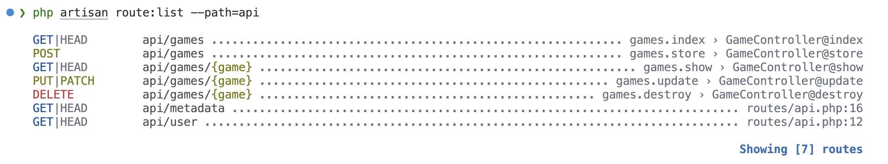

5. User input validation in Laravel uses the same mechanism for both standard Web applications and REST APIs, based on validation rules and using Form Requests to specify validation constraints by HTTP request/endpoint. This means that **specifying validation rules is identical for both** scenarios. The differences between the two are:

    * On traditional web applications, validation checks user inputs from web pages with forms. On a REST API server, validation checks the data in the body of HTTP requests (POST or PUT). (Note: In both cases, data is actually sent in the HTTP request body; the main difference is the encoding format, such as form URL-encoded data versus JSON).    
    
    * The Laravel framework also handles validation errors differently. In traditional web applications, when Laravel detects one or more validation errors, it interrupts execution and redirects the user back to the previous page (the form where the data was entered), passing the error messages via session data. On a REST API server, execution is also interrupted, but the server automatically returns a 422 HTTP response (422 Unprocessable Entity) containing a JSON payload with the error messages.

    For more details on how these mechanisms operate under the hood, check the official [Laravel Validation documentation](https://laravel.com/framework/docs/validation).

    1. Using the exact same approach as a traditional Web application, we will define the Game validation rules using the StoreGameRequest form request. Update the existing file (`api/app/Http/Requests/StoreGameRequest.php`) with the following code, and review its contents.

        ```php
        <?php

        namespace App\Http\Requests;

        use Illuminate\Contracts\Validation\ValidationRule;
        use Illuminate\Foundation\Http\FormRequest;
        use Illuminate\Validation\Rule;

        class StoreGameRequest extends FormRequest
        {
            /**
            * Determine if the user is authorized to make this request.
            */
            public function authorize(): bool
            {
                return true;
            }

            /**
            * Get the validation rules that apply to the request.
            *
            * @return array<string, ValidationRule|array<mixed>|string>
            */
            public function rules(): array
            {
                return [
                    'player1_id' => [
                        'sometimes',
                        'integer',
                        'exists:users,id',
                    ],
                    'type' => ['required', Rule::in(['S', 'M'])],
                    'status' => ['required', Rule::in(['PE', 'PL', 'E', 'I'])],
                    'player2_id' => [
                        'nullable',
                        'required_if:type,M',
                        'exists:users,id',
                        'different:player1_id',
                    ],
                    'player1_moves' => ['nullable', 'integer'],
                    'player2_moves' => ['nullable', 'integer'],
                    'began_at' => ['nullable', 'date'],
                    'ended_at' => ['nullable', 'date'],
                    'total_time' => ['nullable', 'integer'],
                ];
            }

            /**
            * Get the validation messages for invalid fields.
            *
            * @return array<string, string>
            */
            public function messages(): array
            {
                return [
                    'player1_id.integer' => 'Creator ID must be an integer.',
                    'player1_id.exists' => 'The selected player does not exist.',
                    'type.required' => 'Game type is required.',
                    'type.in' => 'Game type must be either S (Single Player) or M (Multiplayer).',
                    'status.required' => 'Game status is required.',
                    'status.in' => 'Game status must be on of: PE - PEnding , PL - PLaying, E - Ended, I - Interrupted ',
                    'player2_id.required_if' => 'Player 2 is required for multiplayer games.',
                    'player2_id.exists' => 'The selected player does not exist.',
                    'player2_id.different' => 'Player 2 must be different from the creator.',
                ];
            }
        }
        ```

    2. Answer the following questions:
        1. What does the `sometimes` rule do?
        2. What do the arguments `users` and `id` of the `exists` rule do?
        3. What is the functionality of the `messages` function?
        
6.	Update the following methods on the `app/Http/Controllers/GameController.php` file:

    ```php
    // ...
    use App\Http\Requests\StoreGameRequest; 

    // ...

    public function index()
    {
        return Game::all();
    }

    public function store(StoreGameRequest $request)
    {
        $game = Game::create($request->validated());
        return response()->json($game, 201);
    }

    public function show(Game $game)
    {
        return $game;
    }

    public function update(StoreGameRequest $request, Game $game)
    {
        $game->update($request->validated());
        return response()->json($game);
    }
    ```

7. We can try the new functionality via a REST client, like [**Postman**](https://www.postman.com/) or [**Bruno**](https://www.usebruno.com/). Collections for both are provided in the folder `rest-clients-collections`.

    1. Open a collection in the selected tool (Postman or Bruno) to test the endpoints.

    2. Both collections include a variable named `url` used to define the base URL for the API. Before testing the API endpoints, change the url value to your API base URL (e.g., `http://localhost:8000/api`).

    3. Test a POST request to create a new Game. Using Bruno, it should look like this:

        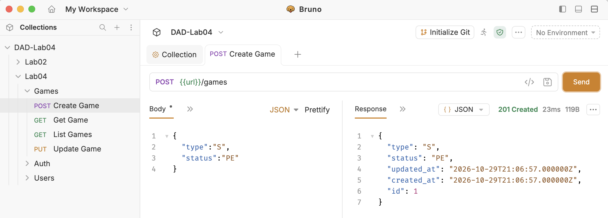

## Axios and API requests from Vue

With the API in place, let’s use [**Axios**](https://axios.rest/) JavaScript Library in the Vue app to make HTTP requests.

8. Install **Axios** library on the Vue.js project by running the following command on the frontend folder:

    ```bash
    npm install --save axios
    ```
9. Update the `App.vue` with the following code (it adds support for **toast** messages using the [**Sonner**](https://www.shadcn-vue.com/docs/components/sonner) component, see if you can spot the changes)

    ```html
    <template>
    <Toaster />
    <nav class="max-w-full p-5 flex flex-row justify-between align-middle">
        <div class="align-middle text-xl">
        <RouterLink to="/"> 🧠 Memory Game </RouterLink>
        </div>
        <NavigationMenu>
        <NavigationMenuList class="justify-around gap-20">
            <NavigationMenuItem>
            <NavigationMenuTrigger>Games</NavigationMenuTrigger>
            <NavigationMenuContent>
                <li>
                <NavigationMenuLink as-child>
                    <RouterLink :to="{name:'singleplayer'}">
                    SinglePlayer Game
                    </RouterLink>
                </NavigationMenuLink>
                <NavigationMenuLink as-child>
                    <RouterLink to="/">MultiPlayer</RouterLink>
                </NavigationMenuLink>
                </li>
            </NavigationMenuContent>
            </NavigationMenuItem>
            <NavigationMenuItem>
            <NavigationMenuLink>
                <RouterLink to="/about">About</RouterLink>
            </NavigationMenuLink>
            </NavigationMenuItem>
            <NavigationMenuItem>
            <NavigationMenuLink>
                <RouterLink to="/">Login</RouterLink>
            </NavigationMenuLink>
            </NavigationMenuItem>
        </NavigationMenuList>
        </NavigationMenu>
    </nav>
    <div>
        <main>
        <RouterView />
        </main>
    </div>
    </template>

    <script setup>
    import {
    NavigationMenu,
    NavigationMenuContent,
    NavigationMenuItem,
    NavigationMenuLink,
    NavigationMenuList,
    NavigationMenuTrigger,
    } from '@/components/ui/navigation-menu'
    import { Toaster } from '@/components/ui/sonner'
    import 'vue-sonner/style.css'
    import { RouterLink, RouterView } from 'vue-router';
    </script>

    <style></style>
    ```

10. Add the following code to the main.js file:

    ```js
    // ...
    const API_BASE_URL = 'http://localhost:8000/api'

    // ...
    const app = createApp(App)

    // ...
    app.provide('apiBaseURL', API_BASE_URL)

    ```

11.	Create a new Pinia store in a file called `stores/api.js` and add the following code:

    ```js
    import { defineStore } from 'pinia'
    import axios from 'axios'
    import { inject } from 'vue'

    export const useAPIStore = defineStore('api', () => {
        const API_BASE_URL = inject('apiBaseURL')

        const postGame = (game) => {
            return axios.post(`${API_BASE_URL}/games`, game)
        }

        const getGames = () => {
            return axios.get(`${API_BASE_URL}/games`)
        }

        return {
            postGame,
            getGames,
        }
    })
    ```

12. Let’s update the Game store (`stores/game.js`) to support saving a game for a guest (unauthenticated user):

    1. Import and use the API store to save the game. Import a toast object and use it to notify the user when the game is successfully saved or when an error occurs. Add the **saveGame** action (function) responsible for storing the game via the API. Ensure that this action (saveGame) is returned by the store and, consequently, available outside the store. Add the following code to the stores/game.js file:

        ```js
        // ...
        import { useAPIStore } from '@/stores/api'
        import { toast } from 'vue-sonner'

        export const useGameStore = defineStore('game', () => {
            // ...
            const apiStore = useAPIStore()
            // ...
            const saveGame = async () => {
                const game = {
                    type: 'S',
                    status: 'E',
                    player1_moves: moves.value,
                    began_at: beganAt.value,
                    ended_at: endedAt.value,
                    total_time: Math.ceil((endedAt.value - beganAt.value)),
                }
                toast.promise(apiStore.postGame(game), {
                    loading: 'Sending data to API...',
                    success: () => {
                        return `[API] Game saved successfully`
                    },
                    error: (data) => `[API] Error saving game - ${data?.response?.data?.message}`,
                })
            }

            return {
                // ...
                saveGame
            }
        })
        ```

13. On the Singleplayer Game page component (`SinglePlayerGamePage.vue`file) change the `isCompleted` **watch** to the following:        

    ```js
    // ...
    import { toast } from 'vue-sonner'
    // ...
    watch(
    () => gameStore.isGameComplete,
    (isComplete) => {
        if (isComplete) {
            gameStore.saveGame()
            toast.success(`Game completed in ${gameStore.totalTimeSeconds} seconds and ${gameStore.moves} moves.`)
            if (gameStore.latestGameHighScore) {
                toast.success(`Congratulations, you've made it to the local high score leaderboard at position ${gameStore.latestGameHighScore + 1}.`)
            }
        }
    })
    ```

14.	Test the application and complete a game, it should look similar to this:    

    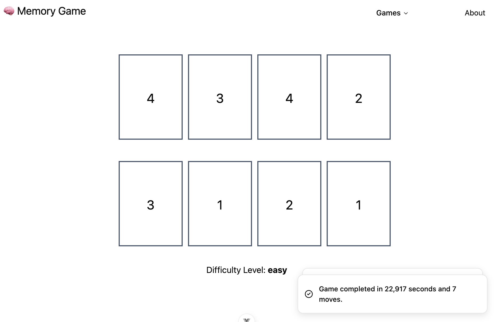

15.	On the Home page component (`HomePage.vue`): 

    1. Import and use the API store
    2. Import the onMounted function
    3. Add the globalHighScores reactive object -  `const globalHighScores = ref( [] )`
    4. Add the following onMounted code:

        ```js
        <script setup>
            // ...
            import { ref, onMounted } from 'vue'
            import { useAPIStore } from '@/stores/api'
            // ...
            const apiStore = useAPIStore()
            // ...
            const globalHighScores = ref( [] )
            // ...
            onMounted(async () => {
                const response = await apiStore.getGames()
                globalHighScores.value = response.data
                .map(item => ({
                    moves: item.player1_moves,
                    time: item.total_time
                }))
                .sort((a, b) => a.time - b.time == 0 ? a.moves - b.moves : a.time - b.time)
                .slice(0, 3)
            })
            // ...
        </script>
        ```

16. In the template, we will add the global high scores alongside the local ones (for the current web session). Global high scores are stored in the database and accessed through the API, while local high scores are stored in the browser's sessionStorage (implemented in the previous worksheet). Replace the `<template></template>` section of the Home Page with the following code:

    ```html
    <template>
    <div class="flex flex-row justify-center items-stretch gap-5 mt-10">
        <Card class="w-full max-w-md">
        <CardHeader>
            <CardTitle class="text-3xl font-bold text-center">
            Single Player
            </CardTitle>
            <CardDescription class="text-center">
            Test your memory by finding matching pairs!
            </CardDescription>
        </CardHeader>
        <CardContent class="space-y-6">

            <div class="space-y-2">
            <label class="text-sm font-medium">Choose Difficulty</label>
            <div class="grid grid-cols-3 gap-2">
                <Button v-for="level in gameStore.difficulties" :key="level.value"
                class="flex flex-col py-3 h-16"
                size="sm"
                :variant="selectedDifficulty === level.value ? 'default' : 'outline'"
                @click="selectedDifficulty = level.value">
                <span class="font-semibold">{{ level.label }} </span>
                <span class="text-xs opacity-70">{{ level.description}}</span>
                </Button>
            </div>
            </div>

            <div class="flex justify-center pb-8">
            <Button size="lg" variant="secondary" class="hover:bg-purple-500 hover:text-slate-200"
                @click="startSinglePlayerGame">
                Start Game
            </Button>
            </div>

            <div class="flex space-x-4">
            <div class="space-y-2 grow">
                <label class="text-sm font-medium">Local High Scores</label>
                <div class="rounded-lg border bg-card text-card-foreground shadow-sm  mt-2">
                <div class="max-h-64 overflow-y-auto">
                    <div v-if="highScoreStore.highScores.length === 0" class="p-6 text-center text-sm text-muted-foreground">
                    No local high scores yet.<br>Be the first!
                    </div>
                    <div v-else class="divide-y">
                    <div v-for="(time, index) in highScoreStore.highScores" :key="index"
                        class="flex items-center justify-between p-3 hover:bg-muted/50 transition-colors">
                        <div class="flex items-center gap-3">
                        <div class="flex h-8 w-8 items-center justify-center rounded-full text-xs font-bold"
                            :class="{
                            'bg-yellow-100 text-yellow-700 dark:bg-yellow-900 dark:text-yellow-300': index === 0,
                            'bg-gray-100 text-gray-700 dark:bg-gray-800 dark:text-gray-300': index === 1,
                            'bg-orange-100 text-orange-700 dark:bg-orange-900 dark:text-orange-300': index === 2,
                            'bg-muted text-muted-foreground': index > 2
                            }">
                            {{ index + 1 }}
                        </div>
                        <div class="text-muted-foreground text-xs">
                            {{ Intl.NumberFormat('en-US').format(time) }} sec.
                        </div>
                        </div>
                    </div>
                    </div> <!-- v-else -->
                </div>
                </div>
            </div>

            <div class="space-y-2 grow">
                <label class="text-sm font-medium">Global High Scores</label>
                <div class="rounded-lg border bg-card text-card-foreground shadow-sm mt-2">
                <div class="max-h-64 overflow-y-auto">
                    <div v-if="globalHighScores.length === 0"
                    class="p-6 text-center text-sm text-muted-foreground">
                    No global high scores yet.<br>Be the first!
                    </div>
                    <div v-else class="divide-y">
                    <div v-for="(score, index) in globalHighScores" :key="index"
                        class="flex items-center justify-between p-3 hover:bg-muted/50 transition-colors">
                        <div class="flex items-center gap-3">
                        <div class="flex h-8 w-8 items-center justify-center rounded-full text-xs font-bold"
                            :class="{
                            'bg-yellow-100 text-yellow-700 dark:bg-yellow-900 dark:text-yellow-300': index === 0,
                            'bg-gray-100 text-gray-700 dark:bg-gray-800 dark:text-gray-300': index === 1,
                            'bg-orange-100 text-orange-700 dark:bg-orange-900 dark:text-orange-300': index === 2,
                            'bg-muted text-muted-foreground': index > 2
                            }">
                            {{ index + 1 }}
                        </div>
                        <div>
                            <div class="font-medium text-sm">{{ score.moves }} Moves</div>
                            <div class="text-xs text-muted-foreground">
                            {{ Intl.NumberFormat('en-US').format(score.time) }} sec.
                            </div>
                        </div>
                        </div>
                    </div>
                    </div> <!-- v-else -->
                </div>
                </div>
            </div>
            </div>
        </CardContent>
        </Card>
        <Card class="w-full max-w-md">
        <CardHeader>
            <CardTitle class="text-3xl font-bold text-center">
            MultiPlayer
            </CardTitle>
            <CardDescription class="text-center">
            Comming Soon!!
            </CardDescription>
        </CardHeader>
        <CardContent class="space-y-6">
        </CardContent>
        </Card>
    </div>
    </template>
    ```

    1. Analyse the section responsible for displaying the Global High Scores.

17.	Test the application, it should look similar to this:    

    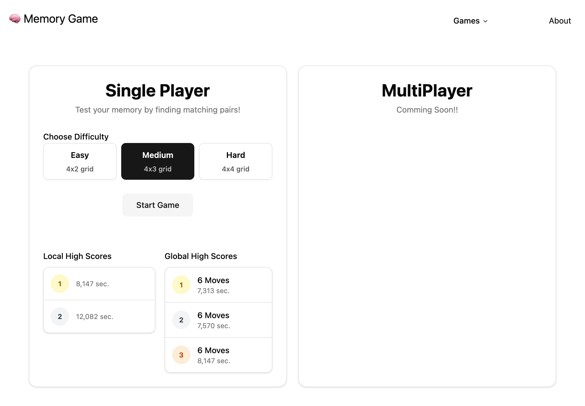

18.	Answer the following questions:
    1. Is there an advantage to having the API calls in a separate Pinia store?
    2. Is our approach on the Highscores appropriate? Can you see a potential problem? What is the alternative implementation? 


## Authentication

In this section, we will set up the authentication and authorization mechanisms for our API using token-based authentication. For this purpose, we will leverage Laravel's auth middleware and Laravel [**Sanctum**](https://laravel.com/framework/docs/sanctum) to issue, manage, and validate API tokens.

In this section, we will set up the authentication and authorization mechanisms for our API using token-based authentication. For this purpose, we will leverage Laravel's auth middleware and [**Laravel Sanctum**](https://laravel.com/framework/docs/sanctum). Sanctum allows us to issue personal access tokens to authenticate API requests to our application; when making these requests, the token must be included in the **Authorization header** as a **Bearer token**.

19.	Create a new controller on the api project. Run the following command on the `api`folder:
    ```sh
    php artisan make:controller AuthController
    ```

20.	Make sure you have a user by running the migrations and seeder with the following command:
    ```sh
    php artisan migrate:fresh --seed
    ```
    * The default user email is **test@example.com** and the password is **password**.

21.	Add the `hasApiToken` trait to the User model (`api/app/Models/User.php` file). The code should look like this:

    ```php
    // ...
    use Laravel\Sanctum\HasApiTokens;
    // ...
    class User extends Authenticatable
    {
        use HasApiTokens, HasFactory, Notifiable;
        // ...
    ```

22.	Add the following code to the newly created `AuthController` class file:    

    ```php
    <?php

    namespace App\Http\Controllers;

    use Illuminate\Http\Request;
    use Illuminate\Support\Facades\Auth;
    use Illuminate\Validation\ValidationException;

    class AuthController extends Controller
    {
        public function login(Request $request)
        {
            $request->validate([
                'email' => 'required|email',
                'password' => 'required',
            ]);

            if (! Auth::attempt($request->only('email', 'password'))) {
                throw ValidationException::withMessages([
                    'email' => ['The provided credentials are incorrect.'],
                ]);
            }

            $user = Auth::user();
            $token = $user->createToken('auth_token')->plainTextToken;

            return response()->json([
                'token' => $token,
                'token_type' => 'Bearer',
                'user' => $user
            ]);
        }

        public function logout(Request $request)
        {
            // Revoke the token that was used to authenticate the current request
            $request->user()->currentAccessToken()->delete();

            return response()->json([
                'message' => 'Logged out successfully',
            ]);
        }
    }
    ```

23. Change the `routes/api.php` file to the following: 

    ```php
    <?php
    use Illuminate\Http\Request;
    use Illuminate\Support\Facades\Route;
    use App\Http\Controllers\AuthController;
    use App\Http\Controllers\GameController;

    Route::post('/login', [AuthController::class, 'login']);

    Route::middleware('auth:sanctum')->group(function () {
        Route::get('/users/me', function (Request $request) {
            return $request->user();
        });
        Route::post('logout', [AuthController::class, 'logout']);
    });

    Route::apiResources([
        'games' => GameController::class
    ]);

    Route::get('metadata', function () {
        return [
            "name" => "DAD Worksheet API",
            "version" => "0.0.1"
        ];
    });
    ```

24. Try out the POST `login`, POST `logout`, and GET `users/me` endpoints using a REST client like **Bruno** or **Postman**.

    * Bearer Authentication: The `users/me` and `logout` endpoints are only accessible when a valid token is sent in the **Authorization header** using the Bearer scheme—which is essentially a string with the format: "`Bearer <token>`"

    * Collection Setup: To simplify testing, the provided collections already include a variable named **token**, and the `logout` and `users/me` requests are already pre-configured to use it in their headers (check the requests headers). After executing a successful login request, simply update the token variable with the received value.

    * API Response Format: Ensure Laravel handles requests as API calls by adding the `Accept: application/json` header. This enforces API-style error handling—meaning for example, that if access is unauthorized (e.g., calling `users/me` without a valid token), the endpoint returns a `401 Unauthorized` response with a JSON payload instead of redirecting to a web login page.

    * Test: To test error handling, first call the `users/me` endpoint with an invalid or missing token—both with and without the Accept header—and compare the server responses. Then, repeat the same error test using the logout endpoint and observe the results. Finally, revoke a token using the logout endpoint and try to reuse that same token on the users/me or logout endpoints.

    * Note: The `users/me` and `logout` endpoints are protected, as they are only available to authenticated users who pass a valid token in the Authorization header. Laravel implements this automatically by adding the **auth:sanctum** middleware to the route definitions. This can be complemented with other authorization mechanisms, namely **Laravel gates and policies**, to restrict access to certain resources based on the authenticated user's role or permissions. Applying these mechanisms in a Laravel API is identical to applying them in a traditional Laravel web application. Read more about them in the [Laravel Authorization documentation](https://laravel.com/framework/docs/authorization).

25. Now let's implement the login UI on the frontend. Start by adding the following elements to the API store, and expose the actions while keeping the token reactive state private. Add the following code to the API store:

    ```js
        // ...
        import { ref, inject } from 'vue'
        // ...
        const token = ref()
        // ...
        const postLogin = async (credentials) => {
            const response = await axios.post(`${API_BASE_URL}/login`, credentials)
            token.value = response.data.token
            axios.defaults.headers.common['Authorization'] = `Bearer ${token.value}`
        }
        
        const postLogout = async () => {
            await axios.post(`${API_BASE_URL}/logout`)
            token.value = undefined
            delete axios.defaults.headers.common['Authorization']
        }

        const getAuthUser = () => {
            return axios.get(`${API_BASE_URL}/users/me`)
        }

        return {
            // ...            
            postLogin,
            postLogout,
            getAuthUser
        }
    })
    ```
    * **Note**: The line `axios.defaults.headers.common['Authorization'] = Bearer ${token.value}` automatically configures Axios to include the Authorization header with the Bearer token in all subsequent HTTP requests, ensuring that future API calls made by the client are automatically authenticated.

26. Add a new store called **auth** by creating the file `stores/auth.js` with the following content:

    ```js
    import { defineStore } from 'pinia'
    import { ref, computed } from 'vue'
    import { useAPIStore } from './api'

    export const useAuthStore = defineStore('auth', () => {
    const apiStore = useAPIStore()
    const currentUser = ref(undefined)

    const isLoggedIn = computed(() => {
        return currentUser.value !== undefined
    })

    const login = async (credentials) => {
        await apiStore.postLogin(credentials)
        const response = await apiStore.getAuthUser()
        currentUser.value = response.data
        return response.data
    }

    const logout = async () => {
        await apiStore.postLogout()
        currentUser.value = undefined
    }

    return {
        currentUser,
        isLoggedIn,
        login,
        logout,
    }
    })
    ```

27.	In the **App.vue** component (the application's root component):

    1. Import and use the Auth store 

    ```js
    // ...
    import { useAuthStore } from '@/stores/auth'
    // ...
    const authStore = useAuthStore()
    // ...
    ```
    
    2. Add the following navigation menu items after the `about` item:

    ```html
    <NavigationMenuItem v-if="!authStore.isLoggedIn">
        <NavigationMenuLink>
            <RouterLink to="/login">Login</RouterLink>
        </NavigationMenuLink>
    </NavigationMenuItem>
    <NavigationMenuItem v-else>
        <NavigationMenuLink>
        <a @click.prevent="logout">Logout</a>
        </NavigationMenuLink>
    </NavigationMenuItem>
    ```

    3. Add/replace the following code to the template to show the user's name:

    ```html
    <div class="align-middle text-xl">
      <RouterLink to="/"> 🧠 Memory Game </RouterLink>
      <span class="text-xs" v-if="authStore.currentUser">&nbsp;&nbsp;&nbsp; 
            ({{ authStore.currentUser?.name }})
      </span>
    </div>    
    ```

    4. Import toast (`import { toast } from 'vue-sonner'`) for popup messages and add the **logout** method with the following code:

    ```js
    // ...
    import { Toaster } from '@/components/ui/sonner'
    import { toast } from 'vue-sonner'
    // ...
    const logout = () => {
        toast.promise(authStore.logout(), {
            loading: 'Calling API',
            success: () => {
                return 'Logout Sucessfull '
            },
            error: (data) => `[API] Error saving game - ${data?.response?.data?.message}`,
        })
    }
    // ...
    ```

28. Add a new folder for the frontend at `frontend/src/pages/login`. Inside this newly created folder, create the `LoginPage.vue` component file with the following content (template and script code):

    ```html
    <template>
        <div class="flex min-h-screen items-center justify-center bg-gray-50 px-4 py-12 sm:px-6 lg:px-8">
            <div class="w-full max-w-md space-y-8">
                <div>
                    <h2 class="mt-6 text-center text-3xl font-bold tracking-tight text-gray-900">
                        Sign in to your account
                    </h2>
                    <p class="mt-2 text-center text-sm text-gray-600">
                        Enter your credentials to access your account
                    </p>
                </div>

                <form class="mt-8 space-y-6" @submit.prevent="handleSubmit">
                    <div class="space-y-4 rounded-md shadow-sm">
                        <div>
                            <label for="email" class="block text-sm font-medium text-gray-700 mb-1">
                                Email address
                            </label>
                            <Input id="email" v-model="formData.email" type="email" autocomplete="email" required
                                placeholder="you@example.com" />
                        </div>

                        <div>
                            <label for="password" class="block text-sm font-medium text-gray-700 mb-1">
                                Password
                            </label>
                            <Input id="password" v-model="formData.password" type="password" autocomplete="current-password"
                                required placeholder="••••••••" />
                        </div>
                    </div>


                    <div>
                        <Button type="submit" class="w-full"> Sign in </Button>
                    </div>

                    <div class="text-center text-sm">
                        <span class="text-gray-600">Don't have an account? </span>
                        <a href="#" class="font-medium text-blue-600 hover:text-blue-500">
                            Sign up
                        </a>
                    </div>
                </form>
            </div>
        </div>
    </template>
    ```

    ```js
    <script setup>
    import { ref } from 'vue'
    import { Input } from '@/components/ui/input'
    import { Button } from '@/components/ui/button'

    import { useAuthStore } from '@/stores/auth'
    import { useRouter } from 'vue-router'
    import { toast } from 'vue-sonner'

    const authStore = useAuthStore()
    const router = useRouter()

    const formData = ref({
        email: 'test@example.com',
        password: 'password'
    })

    const handleSubmit = async () => {
        toast.promise(authStore.login(formData.value), {
            loading: 'Calling API',
            success: (data) => {
                return `Login Sucessfull - ${data?.name}`
            },
            error: (data) => `[API] Error saving game - ${data?.response?.data?.message}`,
        })
        router.push('/')
    }
    </script>
    ```

29.	Add a new route to the Vue Router index file (`frontend/src/router/index.js`) to handle the login page. Additionally, update the navigation menu in App.vue to use the route name instead of the raw path.

30. Add the Auth store to the Game store (`file frontend/src/storee/game.js`) and add the following element when saving game payload:

    ```js
    // ...
    import { useAuthStore }  from '@/stores/auth'
    // ...
    const authStore = useAuthStore()
    // ...    
    const saveGame = async () => {
        const game = {
            // ...
            player1_id: authStore.currentUser ? authStore.currentUser.id : undefined,
            // ...
        }
    // ...
    ```

31. Try out the login and logout functionality. Additionally, try finishing a game while logged in and analyze the payload of the HTTP request sent to save the game (POST /games).

## Resources and Relationships

32.	Back to the API (Laravel) project, let's create a new controller, and a new Resource, two FormRequests for the User model with the following commands:

    ```php
    php artisan make:controller UserController --api
    php artisan make:resource UserResource
    php artisan make:request StoreUserRequest
    php artisan make:request UpdateUserRequest
    ```

33. The **StoreUserRequest** will be responsible for validating `POST users` HTTP requests (for creating a new user), while the **UpdateUserRequest** will validate `PUT users` requests (for updating an existing user). Let's add the code for both:

    1. Code for the `api/app/Http/Requests/StoreUserRequest.php` file:
    
    ```php
    <?php
    namespace App\Http\Requests;

    use Illuminate\Foundation\Http\FormRequest;

    class StoreUserRequest extends FormRequest
    {
        public function authorize(): bool
        {
            return true;
        }

        public function rules(): array
        {
            return [
                'name' => ['required', 'string', 'max:255'],
                'email' => ['required', 'string', 'email', 'max:255', 'unique:users,email'],
                'password' => ['required', 'string', 'min:3'],
            ];
        }
    }
    ```

    2. Code for the `api/app/Http/Requests/UpdateUserRequest.php` file:
    
    ```php
    <?php

    namespace App\Http\Requests;

    use Illuminate\Foundation\Http\FormRequest;
    use Illuminate\Validation\Rule;

    class UpdateUserRequest extends FormRequest
    {
        public function authorize(): bool
        {
            return true;
        }

        public function rules(): array
        {
            return [
                'name' => ['required', 'string', 'max:255'],
                'email' => [
                    'sometimes',
                    'string',
                    'email',
                    'max:255',
                    Rule::unique('users')->ignore($user->id)
                ],
                'password' => ['sometimes', 'string', 'min:3'],
            ];
        }
    }
    ```

34.	Implement the index, store, update, and show methods in **UserController**, following the same patterns used in GameController. Copy the following code into the `api/app/Http/Controllers/UserController.php`:

    ```php
    <?php

    namespace App\Http\Controllers;

    use App\Http\Requests\StoreUserRequest;
    use App\Http\Requests\UpdateUserRequest;
    use App\Models\User;

    class UserController extends Controller
    {
        /**
        * Display a listing of the resource.
        */
        public function index()
        {
            return User::all();
        }

        /**
        * Store a newly created resource in storage.
        */
        public function store(StoreUserRequest $request)
        {
            $user = User::create($request->validated());

            return response()->json($user, 201);
        }

        /**
        * Display the specified resource.
        */
        public function show(User $user)
        {
            return $user;
        }

        /**
        * Update the specified resource in storage.
        */
        public function update(UpdateUserRequest $request, User $user)
        {
            $user->update($request->validated());

            return response()->json($user);
        }

        /**
        * Remove the specified resource from storage.
        */
        public function destroy(User $user)
        {
            //
        }
    }
    ```

35. Add the **apiResource** routes associated with the **UserController** to the `routes/api.php` file, following the same pattern used for the GameController.

36.	Uncomment the user factory line the `api/database/seeders/DatabaseSeeder.php` file and run the migrations and seeder again.

    ```php
    public function run(): void
    {
        User::factory(10)->create();

        User::factory()->create([
            'name' => 'Test User',
            'email' => 'test@example.com',
        ]);
    }
    ```
37. Test the user-related API endpoints in your REST client. You should see the full set of user attributes from the users database table, except those marked as hidden in the model (check the `api/app/Models/User.php`file).

38. Returning raw database records, as seen in current user-related endpoints, isn’t always ideal. You often need to transform the data—simplifying or reshaping the payload, or protecting sensitive fields. In Laravel, that’s what **API resources** are for (refer to the [Laravel Eloquent: API Resources Documentation](https://laravel.com/framework/docs/eloquent-resources)). Let's use **UserResource** to transform the raw data into a structured format. 
Update the `toArray` method in UserResource (located at `api/app/Http/Resources/UserResource.php`) to the following:

    ```php
    public function toArray(Request $request): array
    {
        return [
            'name' => $this->name,
            'email' => $this->email,
        ];
    }
    ```

39. To use an API resource from the controller, either instantiate it for a single model instance or call its static `collection()` method for multiple models. Change the `index`, `store`, `update`, and `show` methods of the UserController (`api/app/Http/Controllers/UserController.php`) to use the UserResource, as follows:

    ```php
    // ...
    use App\Http\Resources\UserResource;
    // ...
    class UserController extends Controller
    {
        // ...
        public function index()
        {
            return UserResource::collection(User::all());
        }

        public function store(StoreUserRequest $request)
        {
            $user = User::create($request->validated());
            return new UserResource($user);
        }

        public function show(User $user)
        {
            return new UserResource($user);
        }

        public function update(UpdateUserRequest $request, User $user)
        {
            $user->update($request->validated());
            return new UserResource($user);
        }
    // ...
    }
    ```

40. Using a REST client like like **bruno** or **postman**, test the user-related API endpoints again. Notice how the response data structure differs, both in the returned object's properties and in the overall response structure. Identify the differences.

    1. Previous version when returning data for a single user (raw data):

        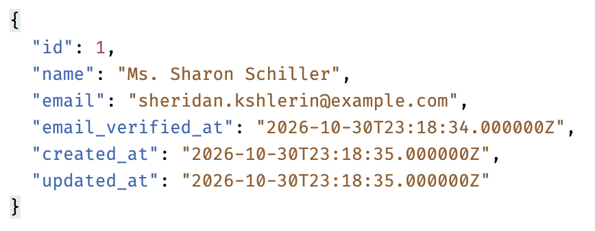

    2. New version when returning data for a single user (after UserResource transformation). Notice that the returned object contains only two properties (`name` and `email`), as defined in the UserResource, and the data is wrapped inside the response's **data** property. 

        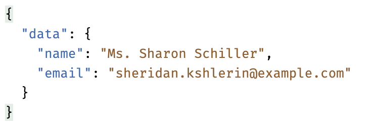

    3. Previous version when returning a collection of users (raw data):

        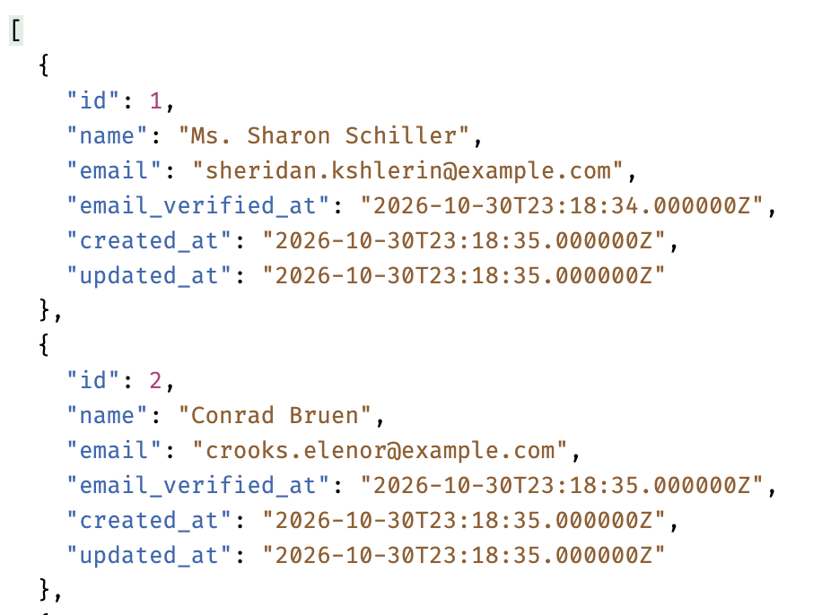

    4. New version when returning a collection of users (after UserResource collection transformation). Note once again that the objects within the collection have only two properties (`name` and `email`), and the collection itself is also wrapped inside the response's **data** property.
    
        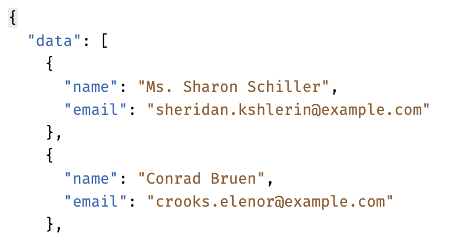

41.	Create a new API resource for the Game model named **GameResource**.

    1. First, create the resource class file by executing the following command:

        ```sh
        php artisan make:resource GameResource
        ```

    2. To specify the new data structure (after transformation), update the `toArray` method with the following code:

        ```php
        // ...
        use App\Http\Resources\UserResource;
        // ...
        public function toArray(Request $request): array
        {
            return [
                'player1' => new UserResource($this->player1),
                'type' => $this->type,
                'status' => $this->status,
                'player1_moves' => $this->player1_moves,
                'total_time' => $this->total_time,
            ];
        }
        // ...
        ```

42. Add a new relationship to the Game model so that we can access the complete information about the player 1 user (refer to the [Laravel Eloquent Relationships Documentation](https://laravel.com/framework/docs/eloquent-relationships)). Update the Game model (located at `api/app/Models/Game.php`) to define the relationship method:

    ```php
    // ...
    use Illuminate\Database\Eloquent\Relations\HasOne;
    // ...
    class Game extends Model
    {
        public function player1(): HasOne
        {
            return $this->hasOne(User::class, 'id', 'player1_id');
        }
    }
    ```
  
43. Change the GameController methods to return game data through the GameResource. Update the following code of the GameController:

    ```php
    // ...
    use App\Http\Resources\GameResource;

    class GameController extends Controller
    {
        public function index()
        {
            return GameResource::collection(Game::all());
        }

        public function store(StoreGameRequest $request)
        {
            $game = Game::create($request->validated());
            return new GameResource($game);
        }

        public function show(Game $game)
        {
            return new GameResource($game);
        }

        public function update(StoreGameRequest $request, Game $game)
        {
            $game->update($request->validated());
            return new GameResource($game);
        }
        // ...
    ```


44. Using a REST client like **bruno** or **postman**, test the game-related API endpoints again. Notice that the game data structure is now nested (like a tree), where the `player1` property itself contains the user object structured according to the UserResource.

    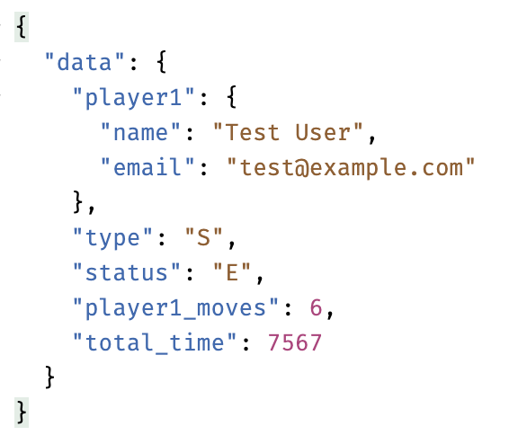

45.	In the Vue.js application, our Home page now has an error. See if you can figure out what happened (tip: check the browser's developer tools network tab and/or the REST client).


46. Change the Global High Scores on the Home page to include the user's name (specifically, player 1's name).

    1. Update the `onMounted` hook to ensure the data returned by the API is accessed correctly—remember that the response data is now wrapped inside the data property. Also, ensure that the resulting scores include a property `player1Name`.

    2. On the template, add the user's (player 1) name below the time, ensuring that the Global High Scores looks like this:
    
        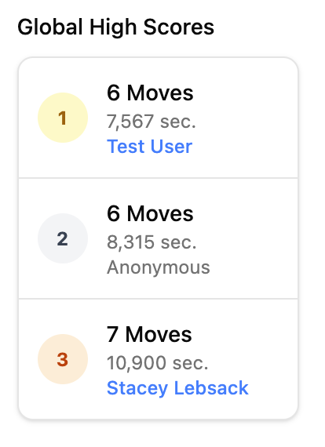
    
47. Test the application. It should be possible to log in and log out, and when the game is finished, it is stored in the database through the API. The Home page will include Local High Scores for the current browser session and Global High Scores from the database, and it should look like this:

    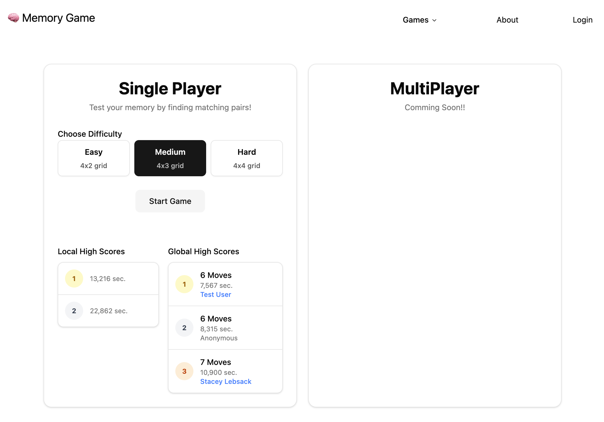
