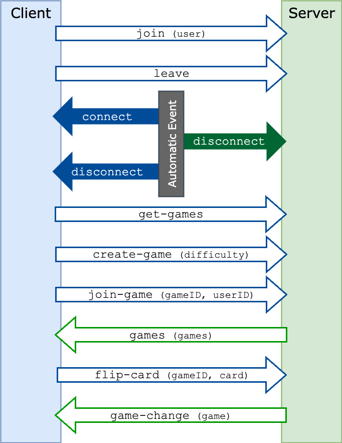
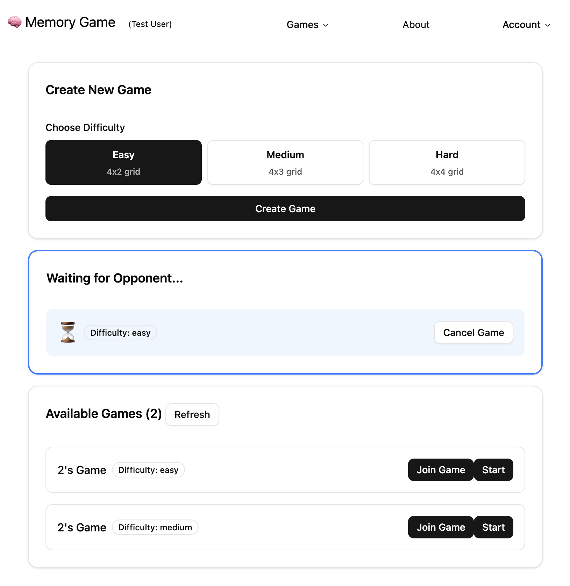
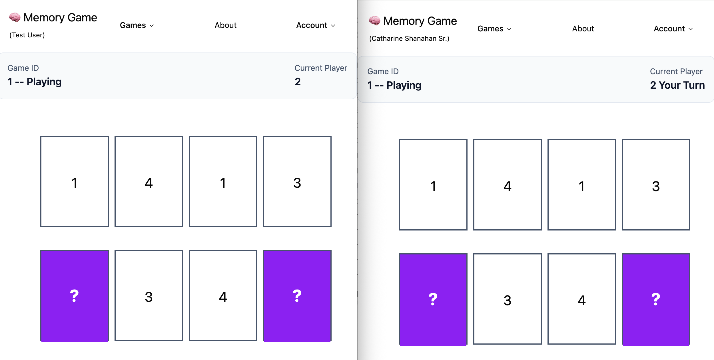

#

# Desenvolvimento de Aplicações Distribuídas

# Lab 5 - MultiPlayer Game - WebSockets

## Objective

This worksheet will allow us to start using the Web Socket Server (Socket.io) to implement a multiplayer game.

## Prerequisites

This section builds upon everything covered in worksheets 4 (Lab04-DataPersistence) where we implemented the REST API, including data persistence, authentication and data transformation. 

To avoid any inconsistencies, use the provided solution repository by following the instructions in [Initial Setup](initial_setup.md) to set up your development environment and install the dependencies for all projects.


## Messages Summary

To implement the multiplayer game, we have to establish real-time communication between the client (frontend application) and the WebSocket server using WebSockets. Throughout this worksheet, we will use a set of messages, as depicted in the following diagram:



* **join (user)**: Sent by the client to register the authenticated user on the WebSocket server right after establishing the connection, allowing the socket to be associated with the respective user profile.

* **leave**: Sent by the client to signal an intentional exit from the game context or lobby, enabling the server to clean up active associations.

* **connect**: An automatic event triggered by the socket engine when the bidirectional connection between the client and the WebSocket server is successfully established.

* **disconnect**: An automatic event triggered when the connection is terminated (whether due to browser closure, network loss, or session termination), allowing the server to update presence status and remove inactive users.

* **get-games**: Requested by the client to ask the server for the updated list of all available games in the lobby.

* **create-game (difficulty)**: Sent by the client to request the creation of a new match, transmitting the intended difficulty level (difficulty).

* **join-game (gameID, userID)**: Sent by the client to request joining an existing game, identifying the game (gameID) and the user joining (userID).

* **games (games)**: Sent by the server to transmit the updated list of available games (games) to all connected clients so that they can update the lobby.

* **flip-card (gameID, card)**: Sent by a player during a match to indicate the intent to flip a specific card (card) in a given game (gameID).

* **game-change (game)**: Sent by the server to propagate the updated match state (game) to both players whenever a change occurs (such as a flipped card, turn switch, or game completion).


## Join WebSocket Server

Our application will only allow authenticated users to use the Multiplayer feature, so the first thing to set up is to tie the user login to the web socket server.

Before proceeding, we’ll enhance the WebSocket server setup by adding ESLint for code quality enforcement. Also, we will configure the server to automatically restart during development.

1.	Install the ESLint package on the websockets folder by running the following command:

    ```sh
    cd websockets
    npm install --save-dev eslint @eslint/js globals
    ```

2. Run the following command to setup the base config for ESLint:
    ```sh
    npx eslint --init
    ```

* when installing ESLint, choose the following options
    * What do you want to lint? - **JavaScript**
    * How would you like to use ESLint? - **To check syntax and find problems**
    * What type of modules does your project use? - **JavaScript modules (import/export)**
    * Which framework does your project use? - **None of these**
    * Does your project use TypeScript? - **No**
    * Where does your code run? - **Node**
    * eslint, @eslint/js, globals
        * Would you like to install them now?  - **Yes**
        * Which package manager do you want to use? - **npm**

* After the installation is completed, the file **eslint.config.js** is created in the WebSocket server folder. This files includes the ESLint configuration and the rules that will be applied to the project. You can customize the rules in this file according to your preferences.
* Check the ["Getting Started with ESLint" documentation](https://eslint.org/docs/latest/use/getting-started) for more information.


3. Change the **dev** script on the `websockets/package.json` file to include the parameter **--watch**, so that the server automatically restarts when changes are made to the code. The updated script should look like this:

    ```js
    {
        . . . 
        "scripts": {
            . . . 
            "dev": "node --watch index.js"
        }
    },
    ```

4. Run the following command to start the WebSocket server in development mode:

    ```sh
    npm run dev
    ```

    * Modify the `index.js` file (for example, by adding a comment) and save it. The server should restart automatically whenever a change is detected in any of the project's JavaScript files, displaying a message like this:

        ```
        Change detected in '. . . /websockets/index.js'
        Restarting 'index.js'
        ```

5. Create a file called `server.js` on the `websockets` folder and add the provided code to it:

    ```js
    import { Server } from "socket.io"
    import { handleConnectionEvents } from "./events/connection.js"
    //import { handleGameEvents } from "./events/game.js"

    export const server = {
        io: null,
    }

    export const serverStart = (port) => {
        server.io = new Server(port, {
            cors: {
                origin: "*",
            },
        })
        server.io.on("connection", (socket) => {
            console.log("New connection:", socket.id)

            handleConnectionEvents(server.io, socket)
            //handleGameEvents(server.io, socket)
        })
    }
    ```

6. Change the contents of `index.js` (the main entry point file) to the following:

    ```js
    import { serverStart } from "./server.js"
    
    const PORT = process.env.PORT || 3000
    
    serverStart(PORT)
    
    console.log(`Socket.io server running on port ${PORT}`)
    console.log("Waiting for connections...")
    ```

    * The `server.js` file is responsible for setting up the WebSocket server and handling incoming connections, whereas `index.js` acts as the main entry point, starting the server and logging relevant startup information to the console.

    * Note: The port defaults to 3000, but can be customized by setting the **PORT** environment variable to a different value.

7. Create two folders – `events` and `state` – on the websockets folder

8. Create the file `connection.js` in the `websockets/state` folder with the following content:

    ```js

    const users = new Map()

    export const addUser = (socket, user) => {
        users.set(socket.id, user)
    }

    export const removeUser = (socketID) => {
        const userToDelete = { ... users.get(socketID)} 
        users.delete(socketID)
        return userToDelete
    }

    export const getUser = (socketID) => {
    return users.get(socketID)
    }

    export const getUserCount = () => {
    return users.size
    }

    ```

    * The objective of state/**connection.js** is to implement simple session management to keep track of logged-in users. We will set up a Map using the socket ID as the key (used to identify each user) and the user object as the value.

    * Note that this implementation only handles logged-in users—anonymous users will not be tracked.

    * Additionally, this implementation is not persistent, meaning that all user data will be lost if the server restarts.

    
9. Create the file `connection.js` inside the `websockets/events` folder with the following content:

    ```js
    import { addUser, removeUser, getUserCount } from "../state/connection.js"

    export const handleConnectionEvents = (io, socket) => {
        socket.on("join", (user) => {
            addUser(socket, user)		
            console.log(`[Connection] User ${user.name} has joined the server`)
            console.log(`[Connection] ${getUserCount()} users online`)		
        })
        
        socket.on("leave", () => {
            const user = removeUser(socket.id)
            console.log(`[Connection] User ${user.name} has left the server`)
            console.log(`[Connection] ${getUserCount()} users online`)
        })
        
        socket.on("disconnect", () => {
            console.log("Connection Lost:", socket.id)
            const user = removeUser(socket.id)
            console.log(`[Connection] ${getUserCount()} users online`)
        })  	
    }
    ```

    * The events/**connection.js** file defines event listeners for events related to user connection and disconnection on the WebSocket server. It listens for the `join` and `leave` events, which must be emitted by the client when a user logs in (authenticates) or logs out. It also listens for the `disconnect` event, which is automatically emitted by the Socket.io server when the connection between the client and the server is lost. The event handlers update the user session state accordingly. 
    
        Check [Messages Summary](#messages-summary) for a description of the events used in this implementation.


10. Next, we will update how our **Vue.js frontend** application handles WebSockets.
    Start by creating a Pinia store for the WebSocket named **socket.js** (file `src/stores/socket.js`), with the following content:

    ```js
    import { defineStore } from 'pinia'
    import { inject, ref } from 'vue'
    import { useAuthStore } from './auth'

    export const useSocketStore = defineStore('socket', () => {
        const socket = inject('socket')
        const authStore = useAuthStore()

        const joined = ref(false)

        const emitJoin = (user) => {
            if (joined.value) return
            console.log(`[Socket] Joining Server`)
            socket.emit('join', user)
            joined.value = true
        }

        const emitLeave = () => {
            socket.emit('leave')
            console.log(`[Socket] Leaving Server`)
            joined.value = false
        }

        const handleConnection = () => {
            socket.on('connect', () => {
                console.log(`[Socket] Connected -- ${socket.id}`)
                if (authStore.isLoggedIn && !joined.value) {
                        emitJoin(authStore.currentUser)
                    }
                })

            socket.on('disconnect', () => {
                joined.value = false
                console.log(`[Socket] Disconnected -- ${socket.id}`)
            })
        }

        return {
            emitJoin,
            emitLeave,
            handleConnection,
        }
    })
    ```

    * The `socket.js` Pinia store is responsible for managing the WebSocket connection and handling events related to user connection and disconnection. It provides methods to emit `join` and `leave` events, as well as a method to handle the `connect` and `disconnect` events emitted by the Socket.io server. Note that the store uses the auth store to check if the user is logged in and to retrieve the current user information when emitting the join event.

    * The store also keeps track of whether the user has joined the server using the `joined` reactive variable.

    * The events emitted by the client (frontend), `join` and `leave`, are handled by the WebSocket server that we implemented in the previous steps. Note that the event names used on the client (join and leave) must precisely match the event names listened to by the server.

    * The `connect` and `disconnect` events handled by the store are built-in Socket.io events. The `connect` event is automatically triggered on the client when a successful connection to the WebSocket server is established, whereas the `disconnect` event is automatically triggered when the connection is lost or terminated.

        Check [Messages Summary](#messages-summary) for a description of the events used in this implementation.

11. Update the `frontend/src/App.vue` file so that it uses the `socket` store and handles the WebSocket connection and disconnection. Replace the file content with the following code:

    ```html
    <template>
    <Toaster richColors />
    <nav class="max-w-full p-5 flex flex-row justify-between align-middle">
        <div class="align-middle text-xl">
        <RouterLink to="/"> 🧠 Memory Game </RouterLink>
        <span class="text-xs" v-if="authStore.currentUser">&nbsp;&nbsp;&nbsp;
                ({{ authStore.currentUser?.name }})
        </span>
        </div>
        <NavigationMenu>
        <NavigationMenuList class="justify-around gap-20">
            <NavigationMenuItem>
            <NavigationMenuTrigger>Games</NavigationMenuTrigger>
            <NavigationMenuContent>
                <li>
                <NavigationMenuLink as-child>
                    <RouterLink to="/games/singleplayer">SinglePlayer</RouterLink>
                </NavigationMenuLink>
                <NavigationMenuLink as-child>
                    <RouterLink to="/games/lobby">MultiPlayer</RouterLink>
                </NavigationMenuLink>
                </li>
            </NavigationMenuContent>
            </NavigationMenuItem>
            <NavigationMenuItem>
            <NavigationMenuLink>
                <RouterLink to="/about">About</RouterLink>
            </NavigationMenuLink>
            </NavigationMenuItem>
            <NavigationMenuItem v-if="!authStore.isLoggedIn">
            <NavigationMenuLink>
                <RouterLink to="/login">Login</RouterLink>
            </NavigationMenuLink>
            </NavigationMenuItem>
            <NavigationMenuItem v-else>
            <NavigationMenuTrigger>Account</NavigationMenuTrigger>
            <NavigationMenuContent>
                <li>
                <NavigationMenuLink as-child>
                    <RouterLink to="/profile">Profile</RouterLink>
                </NavigationMenuLink>
                <NavigationMenuLink as-child>
                    <RouterLink to="/themes">My Themes</RouterLink>
                </NavigationMenuLink>
                <NavigationMenuLink as-child>
                    <a @click.prevent="logout" class="cursor-pointer">Logout</a>
                </NavigationMenuLink>
                </li>
            </NavigationMenuContent>
            </NavigationMenuItem>
        </NavigationMenuList>
        </NavigationMenu>
    </nav>
    <div>
        <main>
        <RouterView />
        </main>
    </div>
    </template>
    ```
    ```js
    <script setup>
    import {
        NavigationMenu,
        NavigationMenuContent,
        NavigationMenuItem,
        NavigationMenuLink,
        NavigationMenuList,
        NavigationMenuTrigger,
    } from '@/components/ui/navigation-menu'
    import { Toaster } from '@/components/ui/sonner'
    import { toast } from 'vue-sonner'
    import 'vue-sonner/style.css'
    import { RouterLink, RouterView } from 'vue-router'
    import { useAuthStore } from '@/stores/auth'
    import { useSocketStore } from '@/stores/socket'
    import { onMounted } from 'vue'

    const authStore = useAuthStore()
    const socketStore = useSocketStore()

    const logout = () => {
        toast.promise(authStore.logout(), {
            loading: 'Calling API',
            success: () => {
                return 'Logout Sucessfull '
            },
            error: (data) => `[API] Error logging out - ${data?.response?.data?.message}`,
        })
    }

    onMounted(() => {
        socketStore.handleConnection()
        //socketStore.handleGameEvents()
    })
    </script>

    <style></style>
    ```

12. On the Auth store call the `emitJoin` and `emitLeave` methods on the login and logout methods.

    ```js
    // ...
    import { useSocketStore } from './socket'
    // ...
    export const useAuthStore = defineStore('auth', () => {
        // ...
        const socketStore = useSocketStore()

        const login = async (credentials) => {
            await apiStore.postLogin(credentials)
            const response = await apiStore.getAuthUser()
            currentUser.value = response.data
            socketStore.emitJoin(currentUser.value)
            return response.data
        }

        const logout = async () => {
            await apiStore.postLogout()
            socketStore.emitLeave()
            currentUser.value = undefined
        }
        // ...
    ```

13. To test the integration between the WebSocket server and the frontend application for the authentication process, perform the following steps:

    1. Inspecting User Accounts in the Database: You can use the default test account  (`test@example.com`) or inspect the database to find additional user accounts. Since the remaining user accounts are automatically seeded with random emails, you will need to use a tool to query the users table and retrieve valid email addresses for testing. You can use either an extension directly inside your editor—such as the **[SQLite Viewer extension](https://marketplace.visualstudio.com/items?itemName=qwtel.sqlite-viewer)** for Visual Studio Code—or a dedicated external database client, such as **[DataGrip](https://www.jetbrains.com/datagrip/)**, **[DBeaver](https://dbeaver.io/)** or **[TablePlus](https://tableplus.com/)**.
    

    2. Testing Across Multiple Browsers: Open two or more instances of the application in different browser windows or tabs (or using different browsers). Try the login and logout features using these test accounts (the password is `password` for all accounts) and observe the real-time event output in the WebSocket server console.

## Game Lobby

Our next task is to implement the game lobby. This will allow users to create multiplayer games, view games created by other players in real time, and join pending matches to play together.

14. Create the file `MultiplayerGamePage.vue`on the folder `frontend/src/pages/games` with the following content:
    ```html
    <template>
    <div class="space-y-6">
        <div class="flex justify-between items-center p-4 bg-slate-50 rounded-lg border border-slate-200">
            <div>
                <p class="text-sm text-slate-600">Game ID</p>
                <p class="text-lg font-semibold text-slate-900">
                    {{ gameStore.multiplayerGame.id }} -- {{ gameStatus }}
                    <span v-if="gameStore.multiplayerGame.complete">Winner {{ gameStore.multiplayerGame.winner }}</span>
                </p>
            </div>
            <div>
                <p class="text-sm text-slate-600">Current Player</p>
                <p class="text-lg font-semibold text-slate-900">
                    {{ gameStore.multiplayerGame.currentPlayer }}
                    <span v-if="myTurn">Your Turn</span>
                </p>
            </div>
        </div>
        <GameBoard :cards="gameStore.multiplayerGame.cards" @flip-card="flipCard"></GameBoard>
    </div>
    </template>
    ```
    ```js
    <script setup>
    import { toast } from "vue-sonner"
    import { computed, watch } from 'vue'
    import { useGameStore } from '@/stores/game';
    import GameBoard from '@/components/game/GameBoard.vue'
    import { useSocketStore } from "@/stores/socket";
    import { useAuthStore } from "@/stores/auth";

    const gameStore = useGameStore()
    const socketStore = useSocketStore()
    const authStore = useAuthStore()

    const myTurn = computed(() => {
        return gameStore.multiplayerGame.currentPlayer == authStore.currentUserID
    })

    const gameStatus = computed(() => {
        return gameStore.multiplayerGame.complete ? 'Ended' : 'Playing'
    })

    const flipCard = (card) => {
        if (!myTurn.value) return
        if (card.flipped) return
        socketStore.emitFlipCard(gameStore.multiplayerGame.id, card)

    }

    watch(gameStatus, () => {
        if (gameStore.multiplayerGame.winner == authStore.currentUserID) {
            toast.success("You Won!!")
        } else {
            toast.error("You Lose!!")
        }
    })
    </script>

    <style scoped></style>
    ```

15. Create the file `MultiplayerLobbyPage.vue`on the folder `frontend/src/pages/games` with the following content:
    ```html
    <template>
        <div class="container mx-auto p-4">
            <div class="max-w-4xl mx-auto space-y-4">
                <Card>
                    <CardHeader>
                        <CardTitle class="text-lg">Create New Game</CardTitle>
                    </CardHeader>
                    <CardContent class="space-y-4">
                        <div>
                            <label class="text-sm font-medium mb-2 block">Choose Difficulty</label>
                            <div class="grid grid-cols-3 gap-2">
                                <Button v-for="level in gameStore.difficulties" :key="level.value" size="sm"
                                    @click="selectedDifficulty = level.value"
                                    :variant="selectedDifficulty === level.value ? 'default' : 'outline'"
                                    class="flex flex-col py-3 h-16">
                                    <span class="font-semibold">{{ level.label }}</span>
                                    <span class="text-xs opacity-70">{{ level.description }}</span>
                                </Button>
                            </div>
                        </div>
                        <Button @click="createNewGame" class="w-full">Create Game</Button>
                    </CardContent>
                </Card>
                <Card class="border-2 border-blue-500">
                    <CardHeader>
                        <CardTitle class="text-lg">Waiting for Opponent...</CardTitle>
                    </CardHeader>
                    <CardContent class="space-y-4">
                        <div class="bg-blue-50 p-4 rounded-lg flex items-center justify-between " v-for="game of myGames"
                            :key="game">
                            <div class="flex-1">
                                <div class="flex items-center gap-2">
                                    <div class="animate-pulse text-3xl">⏳</div>
                                    <Badge variant="outline">Difficulty: {{ game.difficulty }}</Badge>
                                </div>
                            </div>
                            <Button @click="cancelGame(game)" variant="outline" size="sm">Cancel Game</Button>
                            <Button v-if="game.player2" @click="startGame(game)" variant="outline" size="sm">Start</Button>
                        </div>
                    </CardContent>
                </Card>
                <Card>
                    <CardHeader>
                        <CardTitle class="text-lg">Available Games ({{ availableGames.length }})
                            <Button @click="refreshGamesList" variant="outline" size="sm">Refresh</Button>
                        </CardTitle>
                    </CardHeader>
                    <CardContent>
                        <div v-if="availableGames.length === 0" class="text-center py-8 text-gray-500">
                            <div class="text-4xl mb-2">🎮</div>
                            <p>No games available</p>
                            <p class="text-sm mt-1">Create a new game to get started!</p>
                        </div>
                        <div v-else class="space-y-4">
                            <div v-for="game of availableGames" :key="game"
                                class="flex items-center justify-between p-4 border rounded-lg hover:bg-gray-50 transition-colors">
                                <div class="flex-1">
                                    <div class="flex items-center gap-2">
                                        <span class="font-medium">{{ game.creator }}'s Game</span>
                                        <Badge variant="outline">Difficulty: {{ game.difficulty }}</Badge>
                                    </div>
                                </div>
                                <Button @click="joinGame(game)" size="sm">
                                    Join Game
                                </Button>
                                <Button v-if="game.player2 == authStore.currentUserID" @click="startGame(game)" size="sm">
                                    Start
                                </Button>
                            </div>
                        </div>
                    </CardContent>
                </Card>
            </div>
        </div>
    </template>
    ```
    ```js
    <script setup>
    import { ref } from 'vue'
    import { useGameStore } from '@/stores/game'
    import { useAuthStore } from '@/stores/auth'

    import { Card, CardContent, CardHeader, CardTitle } from '@/components/ui/card'
    import { Button } from '@/components/ui/button'
    import { Badge } from '@/components/ui/badge'

    const gameStore = useGameStore()
    const authStore = useAuthStore()

    const selectedDifficulty = ref('medium')
    const myGames = ref([])
    const availableGames = ref([])

    const createNewGame = () => { }
    const refreshGamesList = () => { }
    const joinGame = (game) => { }
    const startGame = (game) => { }
    const cancelGame = (game) => { }
    </script>    
    ```

16. In `frontend/src/router/index.js`, add the following code and review its contents, paying special attention to the router.**beforeEach** call:

    ```js
    import MultiplayerLobbyPage from '@/pages/game/MultiplayerLobbyPage.vue'
    import MultiplayerGamePage from '@/pages/game/MultiplayerGamePage.vue'
    import { useAuthStore } from '@/stores/auth'
    import { toast } from 'vue-sonner'

    const router = createRouter({
        // ...
        // New Routes-  CHILDREN OF path: '/games',
        {
            path: 'lobby',
            name: 'multiplayer-lobby',
            component: MultiplayerLobbyPage,
            meta: { requiresAuth: true },
        },
        {
            path: 'multiplayer',
            name: 'multiplayer',
            component: MultiplayerGamePage,
            meta: { requiresAuth: true },
        },    
    }) // end of createRouter function

    // Route Guards
    router.beforeEach((to) => {
        const authStore = useAuthStore()
        if (to.meta.requiresAuth && !authStore.isLoggedIn) {
            toast.error('This navigation requires authentication')
            return({ name: 'login' })
        } else {
            return
        }
    })
    ```
    
17. On the `frontend/src/stores/socket.js` file add and return the following methods:

    ```js
    import { useGameStore } from './game'
    // ....
    const gameStore = useGameStore()
    // ....
    
    const emitGetGames = () => {
        socket.emit('get-games')
    }
    
    const handleGameEvents = () => {
        socket.on('games', (games) => {
            console.log(`[Socket] server emited games | game count ${games.length}`)
            gameStore.setGames(games) // Import and instantiate the game store
        })
    }

    // ...
    return {
      // ...
      emitGetGames,
      handleGameEvents
    }
    ```

    * Review the integration flow for the lobby focusing solely on the client-side code: the frontend will rely on WebSocket messages such as `get-games` (sent from the client to request the list of available multiplayer games) and `games` (received from the server to broadcast the updated list of active multiplayer games). Note that these specific events have not yet been implemented on the WebSocket server side—this will be covered in subsequent steps.

        Check [Messages Summary](#messages-summary) for a description of the events used in this implementation.

18. On the `frontend/src/App.vue` file add the call to the new **handleGameEvents** method on the onMounted function – uncomment the corresponding line.

    ```js
    onMounted(() => {
        socketStore.handleConnection()
        socketStore.handleGameEvents()
    })
    ```

19. Add the following code to the `frontend/src/stores/game.js` file, and return the new elements:

    ```js
    // ...
    import { ref, computed, watch, inject } from 'vue'
    // ...
    import { toast } from 'vue-sonner'
    // ...
    const socket = inject('socket') 
    // ...

    // Lobby / Multiplayer
    const games = ref([])

    const createGame = (difficulty = 'medium') => {
        if (!authStore.currentUser) {
            toast.error('You must be logged in to create a game')
            return
        }
        if (!socket || !socket.connected) {
            toast.error('Not connected to server. Please refresh the page.')
            return
        }
        socket.emit('create-game', difficulty)
    }

    const setGames = (newGames) => {
        games.value = newGames
        console.log(`[Game] Games changed | game count ${games.value.length}`)
    }

    const myGames = computed(() => {
        return games.value.filter((game) => game.creator == authStore.currentUser.id)
    })

    const availableGames = computed(() => {
        return games.value.filter((game) => game.creator != authStore.currentUser.id)
    })

    // ...
    return {
        // ...
        // Multiplayer:
        games,
        createGame,
        setGames,
        myGames,
        availableGames
    }    
    ```

        Check [Messages Summary](#messages-summary) for a description of the events used in this implementation.

20. In the `frontend/src/pages/game/MultiplayerLobbyPage.vue` file, implement the following changes:
    
    1. Replace the local reactive variables (`myGames` and `availableGames`) in the template with the ones provided by the **game store** (that use the same names), and remove these two local reactive variables from the component's script. Don't forget to import and use the game store within the `MultiplayerLobbyPage` component.

    2. Call the **socket store's** `emitGetGames` method within the `onMounted` lifecycle hook.

    3. Implement the `createNewGame` method by calling the **game store's** `createGame` action and passing the currently selected difficulty.


21.	Let's go back to the WebSocket server project. Add the file `websockets/state/game.js` with the following content and review the code of that file.

    ```js
    const games = new Map()
    let currentGameID = 0
    
    export const createGame = (difficulty, user) => {
        currentGameID++
        const game = {
            id: currentGameID,
            difficulty,
            creator: user.id,
            player1: user.id,
            player2: null,
        }
        games.set(currentGameID, game)
        return game
    }
    
    export const getGames = () => {
        return games.values().toArray()
    }
    ```


22. Next, add the file `websockets/events/game.js` to the WebSocket server with the following content and review the code of that file.

    ```js
    import { getUser } from "../state/connection.js"

    import { createGame, getGames } from "../state/game.js"

    export const handleGameEvents = (io, socket) => {
        socket.on("create-game", (difficulty) => {
            const user = getUser(socket.id)
            const game = createGame(difficulty, user)
            socket.join(`game-${game.id}`)
            console.log(`[Game] ${user.name} created a new game - ID: ${game.id}`)
            io.emit("games", getGames())
        })
    
        socket.on("get-games", () => {
            socket.emit("games", getGames())
        })
    }
    ```

        Check [Messages Summary](#messages-summary) for a description of the events used in this implementation.

24. Call the `handleGameEvents(io, socket)` function in `websockets/server.js` within the connection handler. The code is already included—you just need to uncomment the references to handleGameEvents (both the import and its execution).

25. Test the application using two different browsers. The application should allow both users to create games, and any game created by one user must appear instantly in the other user's list of available games. You should see something similar to the following:

    


## Multiplayer Game

With a very simple lobby operational, now we will implement support for the multiplayer games.

25. On the frontend (Vue.js) project, add and return the following computed in the **auth store** file (`frontend/src/stores/auth.js`):

    ```js
    // ...
    const currentUserID = computed(() => {
        return currentUser.value?.id
    })

    return {
        // ...
        currentUserID
    }
    ```

26. Add and return the following elements in the **socket store** file (`frontend/src/stores/socket.js`):

    ```js
    // ...
    const emitJoinGame = (game) => {
        console.log(`[Socket] Joining Game ${game.id}`)
        socket.emit('join-game', game.id, authStore.currentUser.id)
    }

    const emitFlipCard = (gameID, card) => {
        socket.emit('flip-card', gameID, card)
    }

    return {
        // ...
        emitJoinGame,
        emitFlipCard
    }
    ```

        Check [Messages Summary](#messages-summary) for a description of the events used in this implementation.

27.	Add the following socket event listener to the `handleGameEvents` function of **socket store** file (`frontend/src/stores/socket.js`):

    ```js

    const handleGameEvents = () => {
        // ...
        socket.on('game-change', (game) => {
            gameStore.setMultiplayerGame(game)
        })
    }
    ```

        Check [Messages Summary](#messages-summary) for a description of the events used in this implementation.

28.	Add or replace `joinGame` and `startGame`functions of the `frontend/src/pages/game/MultiplayerLobbyPage.vue` component:

    ```js
    // ...
    import { useRouter } from 'vue-router'
    // ...
    const router = useRouter()
    // ...

    const joinGame = (game) => {
        socketStore.emitJoinGame(game)
    }

    const startGame = (game) => {
        gameStore.multiplayerGame = game
        router.push({ name: 'multiplayer' })
    }
    // ...
    ```

29. Add and return the following elements to the **game store** file (`frontend/src/stores/game.js`):

    ```js
    // ...
    const multiplayerGame = ref({})

    const setMultiplayerGame = (game) => {
        multiplayerGame.value = game
        console.log(`[Game] Multiplayer Game changed | game moves ${game.moves}`)
    }    
    // ...
    return {
        // ...
        multiplayerGame,
        setMultiplayerGame
    }
    ``` 

30. Your frontend (Vue.js) application should now be prepared to handle multiplayer games, but we still need to implement the corresponding events and handlers on the **WebSocket server**. Let's start by implementing the event handlers `join-game` and `flip-card` in the `websockets/events/game.js` file on the WebSocket server project:

    ```js
    // ...
    import { createGame, getGames, joinGame, flipCard, clearFlippedCard} from "../state/game.js"
    // ...
    export const handleGameEvents = (io, socket) => {
        // ...
        socket.on("join-game", (gameID, userID) => {
            joinGame(gameID, userID)
            socket.join(`game-${gameID}`)
            console.log(`[Game] User ${userID} joined game ${gameID}`)
            io.emit("games", getGames())
        })

        socket.on("flip-card", (gameID, card) => {
            const game = flipCard(gameID, card)
            io.to(`game-${gameID}`).emit("game-change", game)
        })        
    }
    ```

    1. Answer the following questions:

        1. What does the ``socket.join(`game-${gameID}`)`` instruction do?
    
        2. We have two **emit** methods associated with the **io** object (io represents the WebSocket server), namely `io.emit(...)` and `io.to(...).emit()`. What does each method do, and what is the difference between them?

        Check [Messages Summary](#messages-summary) for a description of the events used in this implementation.

31. Now we need to implement the game logic on the **WebSocket server**, which we have chosen to handle within the game state file. Let's start by implementing game creation by adding the `options` and `generateBoard` elements and updating the `createGame` function in the `websockets/state/game.js` file:

    ```js
    const games = new Map()

    let currentGameID = 0

    const options = [1, 2, 3, 4, 5, 6, 7, 8].map((i) => {
        return { face: i, matched: false, flipped: false }
    })

    const generateBoard = (difficulty) => {
        const cards = []
        let numPairs = 4
        if (difficulty === "medium") numPairs = 6
        if (difficulty === "hard") numPairs = 8

        const boardOptions = options.slice(0, numPairs)

        let idCounter = 0
        boardOptions.forEach((option) => {
            cards.push({ id: idCounter++, ...option })
            cards.push({ id: idCounter++, ...option })
        })

        for (let i = cards.length - 1; i > 0; i--) {
            const j = Math.floor(Math.random() * (i + 1));
            [cards[i], cards[j]] = [cards[j], cards[i]]
        }
        return cards
    }

    export const createGame = (difficulty, user) => {
        currentGameID++
        const game = {
            id: currentGameID,
            difficulty,
            creator: user.id,
            player1: user.id,
            player2: null,
            winner: null,
            currentPlayer: user.id,
            cards: generateBoard(difficulty),
            flippedCards: [],
            matchedPairs: [],
            started: false,
            complete: false,
            moves: 0,
            beganAt: null,
            endedAt: null,
        }
        games.set(currentGameID, game)
        return game
    }

    export const getGames = () => {
        return games.values().toArray()
    } 
    ```

32. Add the `joinGame` function to the **game state** file (`websockets/state/game.js`) to allow a second player to join an existing game:

    ```js
    export const joinGame = (gameID, player2) => {
        games.get(gameID).player2 = player2
    }
    ```

33. Now, add the following elements to the **game state** file (`websockets/state/game.js`) to handle the card flips and most of the game logic:

    ```js
    // ...
    export const flipCard = (gameID, card) => {
        const game = games.get(gameID)
        
        if (!game.beganAt) {
            game.beganAt = new Date()
            game.started = true
        }

        const gameCard = game.cards.find((c) => c.id == card.id)
        if (game.flippedCards.includes(gameCard.id)) return
        if (game.matchedPairs.includes(gameCard.id)) return
        if (game.flippedCards.length >= 2) return

        game.flippedCards.push(gameCard.id)
        gameCard.flipped = true
        if (game.flippedCards.length == 2) {
            game.moves++
            checkForMatch(game)
            checkForGameComplete(game)
        }
        return game
    }

    const checkForMatch = (game) => {
        if (game.flippedCards.length !== 2) return

        const [first, second] = game.flippedCards
        const firstCard = game.cards.find((c) => c.id === first)
        const secondCard = game.cards.find((c) => c.id === second)

        if (firstCard.face === secondCard.face) {
            game.matchedPairs.push(first, second)
            firstCard.matched = true
            secondCard.matched = true
            game.flippedCards = []
        } else {
            firstCard.flipped = true
            secondCard.flipped = true
            setTimeout(() => {
                triggerFlipDelay(game)
            }, 1000)
        }
    }

    const checkForGameComplete = (game) => {
        if (game.matchedPairs.length === game.cards.length) {
            game.complete = true
            game.winner = game.currentPlayer
            game.endedAt = new Date()
        }
    }

    export const clearFlippedCard = (game) => {
        if (game.flippedCards.length !== 2) return

        const [first, second] = game.flippedCards
        const firstCard = game.cards.find((c) => c.id === first)
        const secondCard = game.cards.find((c) => c.id === second)
        
        firstCard.flipped = false
        secondCard.flipped = false
        game.flippedCards = []
        game.currentPlayer = game.currentPlayer == game.player1 ? game.player2 : game.player1
        
        return game
    }
    ```


    * Analyze the code. Most of it replicates existing logic from the single-player game, but there are some differences. For instance, the `checkForMatch` function now switches the current player if the cards do not match, and the `checkForGameComplete` function now sets the winner of the game when all pairs have been matched.
    
    * Also, did you notice the `setTimeout` in the `checkForMatch` function? This is how we handle the delay for card flipping—in essence:
    
        * The user clicks a card and the client application sends an event to the server using emit.
        
        * The server handles the flip and emits the updated version of the game to both players (so both users see the flip).
        
        * If the flipped card is the second one, the server first emits the game state with both cards revealed (the first and second flipped cards).
        
        * If the cards do not match, the server waits 1 second before sending (emitting) the board state back to both users with the cards hidden again.

34.	Add this code to the `websockets/events/game.js` file:

    ```js
    import { server } from "../server.js";
    
    export const triggerFlipDelay = (game) => {
        game = clearFlippedCard(game);
        server.io.to(`game-${game.id}`).emit("game-change", game);
    }    
    ```

        Check [Messages Summary](#messages-summary) for a description of the events used in this implementation.

35. Finally, import the `triggerFlipDelay` function into the `websockets/state/game.js` file—it was used in the `checkForMatch` function, but had not yet been imported. Add the following code to the top of the `websockets/state/game.js` file:

    ```js
    import { triggerFlipDelay } from "../events/game.js"
    ```    

36. The game should be playable now. Open the frontend application in two different browsers with two distinct users and try to play a multiplayer game. It should look something like this:



## Final Adjustments (optional)
Try the multiplayer game and find and solve any bug detected. 
Also, make some final adjustments for the game to support "cancel game"; to remove the button to join once the game has started; to replace the start button with a "continue" button when the game is running and to remove it when no longer needed; to remove the game from the lobby when it is finished, to show the lobby on the homepage, etc.

